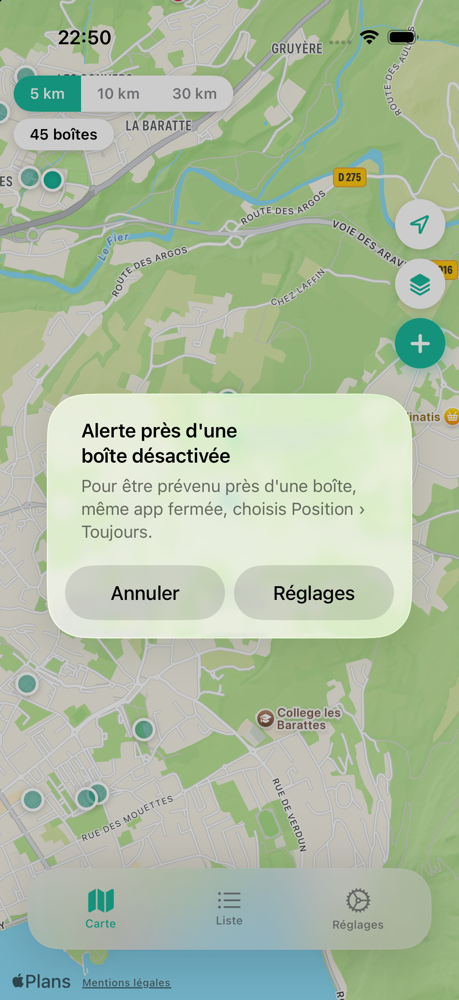

# Boîtes à Livres

<p align="center">
  
</p>

Trouvez les boîtes à livres près de chez vous, partout en France : sur une carte, dans une liste triée par distance, avec leurs photos et les avis de la communauté.

**[Télécharger sur l'App Store](https://apps.apple.com/fr/app/bo%C3%AEtes-%C3%A0-livres/id6768351762)**

Données issues de [boites-a-livres.fr](https://www.boites-a-livres.fr).

---

## Fonctionnalités

- **Carte** : boîtes géolocalisées, filtre de rayon (5, 10, 20 et 50 km), position actuelle.
- **Liste** : boîtes triées par distance, filtre « avec photo ».
- **Fiche** : adresse, coordonnées, ouverture dans Plans, carrousel de photos plein écran.
- **Avis** : noter l'état d'une boîte et le nombre de livres, avec commentaire facultatif (depuis la boîte uniquement).
- **Photos** : ajouter une photo d'une boîte, depuis l'appareil photo ou la bibliothèque.
- **Localisation** : proposer une correction de position si la boîte est ailleurs.
- **Suppression** : demander la suppression d'une boîte disparue, validée par un administrateur.
- **Alerte de proximité** : un rappel quand vous passez près d'une boîte (la position reste sur votre téléphone).
- **Français et anglais** : la langue suit celle de l'iPhone. Mode clair et sombre.

## Captures

<p align="center">
  
</p>

## Stack technique

| Composant | Technologie |
|---|---|
| Interface | SwiftUI |
| Carte | MapKit |
| Backend | Supabase (PostgreSQL, Storage, Edge Functions) |
| Localisation | `fr.lproj` et `en.lproj` |

Aucune dépendance externe : pas de SPM, pas de CocoaPods.

## Commandes

Prérequis : Xcode 16 ou plus, cible iOS 17 ou plus.

```bash
make build          # compile pour le simulateur
make run            # compile, lance le simulateur et installe l'app
make device         # compile et installe sur un iPhone branché
make release-check  # lecture seule : clé App Store Connect, version en ligne, builds
```

L'envoi sur l'App Store (`make release`) exige une confirmation explicite et n'est pas décrit ici.

## Structure du dépôt

```
BoitesALivresNative/
├── App/                  # point d'entrée, navigation par onglets, carte, liste, réglages
├── Views/                # composants partagés, fiche (Detail), formulaires
├── ViewModels/           # logique d'écran
├── Services/             # Supabase, localisation, notifications, cache
├── Models/               # modèles de données
├── Assets.xcassets/      # icône, couleurs
├── en.lproj/ fr.lproj/   # textes en anglais et en français
docs/captures/            # captures d'écran du README
release-notes/            # notes de version (fr-FR, en-US)
scripts/                  # outils de publication et de contrôle
supabase/                 # schéma et fonctions côté serveur
```

Historique des versions : [CHANGELOG.md](CHANGELOG.md).

## Localisation

L'app suit la langue du système, sans sélecteur manuel. Chaque texte affiché a une clé dans `fr.lproj/Localizable.strings` et une traduction dans `en.lproj/Localizable.strings`.

## Contributeurs

Développé bénévolement par [Malik Karaoui](https://malikkaraoui.com).
